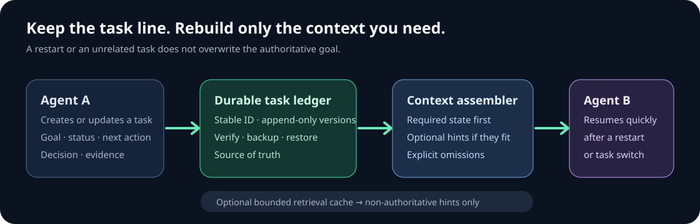
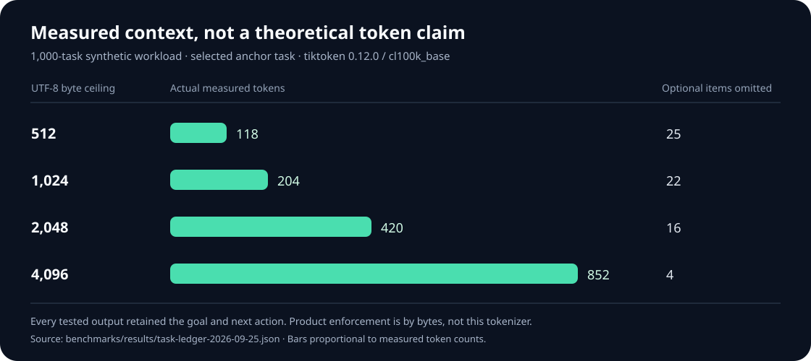

<h1 align="center"> ContextSpindle</h1>

<p align="center"><strong>Durable task continuity for AI agents.</strong><br>Keep the goal and next action across context compaction, restarts, and unrelated work.</p>

<p align="center">
  <a href="https://github.com/reacherwu/ContextSpindle/actions/workflows/ci.yml"></a>
  <a href="https://github.com/reacherwu/ContextSpindle/releases"></a>
  <a href="LICENSE"></a>
</p>

<p align="center"><a href="#try-it-locally">Get started</a> · <a href="https://reacherwu.github.io/ContextSpindle/">Website</a> · <a href="docs/TASK-LEDGER-BENCHMARK.md">Measured results</a> · <a href="README_CN.md">中文说明</a></p>

The persistent task ledger keeps authoritative goals, decisions, and progress. A separate bounded memory engine supplies optional hints. ContextSpindle assembles a focused handoff within a conservative byte budget, so the next agent can resume without replaying the whole conversation. [Product definition](docs/PRODUCT-SCOPE.md) · [Agent protocol](docs/AGENT-PROTOCOL.md) · [Operations](docs/OPERATIONS.md)

## Compact fuse (Claude Code, and any tool with pre/post-compaction hooks)

When Claude Code compacts a long conversation (manually, at the auto-compact window, or via idle compaction), the model's summary can keep the numbers and drop the reasoning, unfinished tasks, or subagent results. Users have reported exactly this: [#102666](https://github.com/anthropics/claude-code/issues/102666) (idle compaction lost the reasoning), [#32099](https://github.com/anthropics/claude-code/issues/32099) (completed subagent results lost), [#31420](https://github.com/anthropics/claude-code/issues/31420) (request to back up task output before compaction).

The fuse is two documented [Claude Code hooks](https://code.claude.com/docs/en/hooks):

- `PreCompact` (matcher `manual|auto`) → `contextspindle fuse save` reads `transcript_path` from the hook payload and appends a checksummed snapshot to `.contextspindle/fuse/ledger.jsonl` in the session's `cwd`.
- `SessionStart` (matcher `compact`) → `contextspindle fuse restore` prints `hookSpecificOutput.additionalContext`, so the snapshot is in Claude's context right after compaction.

```bash
cargo install --git https://github.com/reacherwu/ContextSpindle continuum-cli   # installs `contextspindle`
contextspindle fuse setup            # preview the merged ~/.claude/settings.json (writes nothing)
contextspindle fuse setup --write    # apply; the old file is kept as settings.json.bak
# per-project instead: contextspindle fuse setup --project --write
```

Setup merges into existing settings, keeps your other hooks, and is idempotent.

**What is saved:** the first user request (carried over across repeated compactions of the same session as "the goal"), open items from the latest `TodoWrite` list and `TaskCreate`/`TaskUpdate` calls, user sentences that state constraints (`don't`, `never`, `must`, `keep`…), assistant sentences that state decisions or findings (`root cause`, `because`, `chose`, `ruled out`…), results returned by `Task`/`Agent` subagents, the last three user requests, where the assistant left off, and edited file paths. The re-injected text is capped at 6,000 bytes by default (`--budget`, max 9,500; Claude Code caps hook context at 10,000 characters). Lower-priority sections are dropped first; the goal is kept.

**What is not:** this is a deterministic keyword/structure extract, not a model summary. Reasoning phrased without those markers is missed unless it is in the last assistant message. Tool output other than subagent results (file reads, test logs) is not kept. Only the first user request is treated as the goal; if the goal changed mid-session, the newer one appears only under "latest user requests". Task IDs for `TaskUpdate` are matched by creation order, which is a heuristic. Claude Code notes that the transcript is written asynchronously, so the last few messages before compaction may be missing. The extractor reads Claude Code JSONL and generic `{"role","content"}` JSONL; other tools can call `fuse save --transcript PATH --session ID` and `fuse restore --plain` from their own hooks, but only Claude Code is wired up by `setup`. Hooks were exercised with the documented payloads; this has not yet been run inside a live Claude Code session in CI.

**Reproduce in under 5 minutes, offline:** `./examples/fuse/demo.sh` (or `contextspindle fuse demo`). It uses a synthetic 185,408-byte, 95-message transcript ([generator](examples/fuse/make_session.py)) modeled on #102666 and checks 14 probe facts ([list](examples/fuse/probes.txt)) that each appear once in it. Measured on Linux x86_64 (8 vCPU Xeon), release build:

| Budget (bytes) | Probe facts in re-injected context | Sections dropped |
| ---: | ---: | --- |
| 6,000 (default) | 14/14 (context was 1,738 bytes) | none |
| 2,000 | 14/14 | none |
| 1,500 | 12/14 | files, last message, recent requests |
| 1,000 | 6/14 | + decisions, subagent results |
| 600 | 5/14 | + constraints |

`fuse save` took 2.5 ms and `fuse restore` 2.1 ms as separate CLI processes (median of 11). We wrote both the transcript and the probes, so 14/14 shows the extractor does what it was designed to do on this scenario; it is not evidence about real sessions.

## Why we built it

A long conversation can be compressed. An agent may switch to another task, restart, or return much later. If the only record of the original goal lives in a chat window or an evicting retrieval cache, the agent can lose the task line even while remembering scattered details. ContextSpindle separates the two jobs: a persistent task ledger keeps authoritative state; a bounded memory engine supplies optional retrieval hints. Resuming starts with the task, not with a dump of every conversation.



The ledger records a stable task ID, goal, completion criteria, status, owner, blocker, next action, parent and dependencies, decisions, evidence, notes, and version history. Updates are serialized across local processes; an expected version detects concurrent edits. Completed dependencies and a cleared blocker are required before marking a task done. Checksum verification, backup, and restore are built in. The `contextspindle task context` command keeps required state intact, includes optional information only if it fits, and reports omissions.

## What a user gets

- **A resumable handoff:** another agent can open the task ID and see what is being done, why, what remains, and what is blocked.
- **Less irrelevant input:** assemble one task's context instead of sending a list of every task. The measured example below shows the size difference for one explicit workload—not a universal savings promise.
- **Auditable changes:** previous versions, decisions, evidence references, and caller-declared actor labels remain available. Actor labels are provenance, not authentication.
- **Recovery independent of retrieval:** losing or corrupting the bounded `.continuum/` cache does not erase the `.contextspindle/tasks/` ledger. Verified backups can be restored into a fresh workspace.
- **A shared local interface:** agents can use the same CLI or 15 MCP tools without relying on one model's private chat history.

## Measured, not imagined

The [reproducible benchmark](benchmarks/task_ledger_product.py) created one anchor task with 24 notes and **999 unrelated tasks** in a fresh workspace. On an Apple M4 / macOS 26.6.2, a release CLI process recovered the anchor's 2,048-byte-budget context in **34.23 ms median** and **35.73 ms p95** across 11 sequential warm-cache runs. The goal and next action were present at every tested budget. The optional retrieval snapshot was then corrupted; the task remained readable. Backup into, and restore from, a fresh workspace also passed. [Raw JSON](benchmarks/results/task-ledger-2026-09-25.json) records the exact outputs and conditions.



| Same 1,000-task test, `cl100k_base` encoding | UTF-8 bytes | Measured tokens |
| --- | ---: | ---: |
| Naively concatenate all 10 paginated task-summary responses | 322,607 | 94,701 |
| Assemble only the anchor task with a 2,048-byte ceiling | 1,908 | 420 |

That selected context was **99.56% smaller in token count for this specific comparison**. The baseline is intentionally naive and the two inputs are not semantically identical. This is evidence that task selection can avoid unrelated input; it is **not** a claim that every user or model saves 99.56% of tokens. The product enforces a conservative UTF-8 byte ceiling, not a model-specific tokenizer. The reported token counts use `tiktoken` 0.12.0 with `cl100k_base` only. The tasks and notes were synthetic; the runtime, outputs, and counts are actual measurements.

| Operation on that 1,000-task workspace | Median | p95 | Runs |
| --- | ---: | ---: | ---: |
| Inbox, 10 tasks | 32.80 ms | 33.92 ms | 11 |
| Search for the anchor | 32.49 ms | 32.89 ms | 11 |
| Assemble anchor context, 2,048-byte ceiling | 34.23 ms | 35.73 ms | 11 |
| Verify all task records | 62.73 ms | 63.44 ms | 11 |

These timings include a fresh CLI process per call with a warm filesystem cache. They do not measure model response time, Linux, cold storage, very long per-task histories, or multi-year durability. The older bounded-memory research and its distinct benchmarks are in [BENCHMARKS.md](docs/BENCHMARKS.md); they are not task-ledger results.

We also used ContextSpindle to track this repository's own rename and publication task. Its version-3 handoff contained the real goal and next action in 1,892 bytes / 438 `cl100k_base` tokens; this is a [dogfood observation](docs/TASK-LEDGER-BENCHMARK.md#real-project-dogfood-observation), not an independently reproducible benchmark, because the operational ledger is Git-ignored.

## Try it locally

Build from this checkout—no global install, hook, or IDE setting change is needed:

```bash
cargo build --release --bin contextspindle
./target/release/contextspindle init .
./target/release/contextspindle task create \
  "Ship the release" --criteria "Tests pass and release is published" \
  --idempotency-key ship-release
```

Copy the returned task ID, then update and resume it:

```bash
./target/release/contextspindle task update TASK_ID \
  --status active --next "Run final tests" --expect-version 1
./target/release/contextspindle task inbox 10
./target/release/contextspindle task context TASK_ID 2048
./target/release/contextspindle task verify
./target/release/contextspindle task backup /path/to/new-backup-directory
```

Use `task search <query>` when an old ID is unknown, `task history <id>` to review changes, and `task restore <backup-directory>` in a new workspace. A task cannot be remembered if no agent ever records it. The [agent protocol](docs/AGENT-PROTOCOL.md) gives the full start/switch/stop workflow, and the [operations runbook](docs/OPERATIONS.md) explains backup and security responsibilities.

The project-scoped [`.mcp.json`](.mcp.json) starts the same server from this checkout. To make task continuity available in **new local Codex conversations across repositories**, use the [personal Codex installer and setup guide](docs/CODEX-INTEGRATION.md); merely cloning the repository does not install a global skill or MCP server. The task tools cover create, update, show, list, inbox, search, context, history, children, verification, backup, and restore. `contextspindle_remember`, `contextspindle_recall`, and `contextspindle_stats` remain available for the bounded cache. The legacy `continuum-cli` command, Python import, Rust crate names, and `.continuum/` snapshot paths remain for compatibility; see the [naming decision](docs/NAME-CHANGE.md).


## Stale evidence gate (S7)

**Threat:** Evidence logged under an older completion criteria, or copied from another task, could still mark a revised (or foreign) task `done`. The historical done gate only required non-empty criteria, a clear blocker, and finished dependencies—not a binding between evidence and the current task.

**Fix (minimal):** `--evidence` stores a backwards-compatible `evidence://v1/{...}` record with `task_id` and `criteria_hash` (SHA-256 of criteria UTF-8 at log time). Marking `status=done` requires at least one evidence record whose `task_id` matches this task and whose `criteria_hash` matches the **current** criteria.

**Measured (this checkout):**

| Case | Before | After |
| --- | --- | --- |
| S7a (criteria changed after evidence) | done **accepted** | done **rejected** (`Evidence is missing or stale…`) |
| S7b (foreign-task bound evidence) | done **accepted** | done **rejected** (`Evidence task id mismatch`) |

Reproduce:

```bash
CARGO_TARGET_DIR=/workspace/tmp/csp-target cargo test -p continuum-cli s7_stale_evidence -- --nocapture
```

Details: [docs/S7-STALE-EVIDENCE.md](docs/S7-STALE-EVIDENCE.md) · results [baseline](benchmarks/results/s7-stale-evidence-baseline.json) / [after](benchmarks/results/s7-stale-evidence-after.json) / [summary](benchmarks/results/s7-stale-evidence.md).

**Limitations:** Legacy plain-string evidence still loads but does **not** satisfy the new done gate (re-log after upgrade or criteria change). The hash covers criteria text only—not goal, notes, or external artifact bytes. This is binding, not cryptographic authentication of actors or artifacts.

## Limits worth knowing

The ledger is local and Git-ignored: **pushing code does not back up tasks**. Schedule protected, off-device backups and test restores if long-term continuity matters. Checksums detect accidental corruption, not malicious rewriting by a user who can edit the workspace. Task text and retrieved hints must be treated as data, not higher-priority instructions. Some list/search operations scan task directories, so measure your own workload before setting a scale target. Deterministic retrieval for a fixed snapshot does not make a language model's response deterministic.

[Source on GitHub](https://github.com/reacherwu/ContextSpindle) · [Contributing](CONTRIBUTING.md) · [Code of Conduct](CODE_OF_CONDUCT.md) · [Security](SECURITY.md) · [License](LICENSE)
